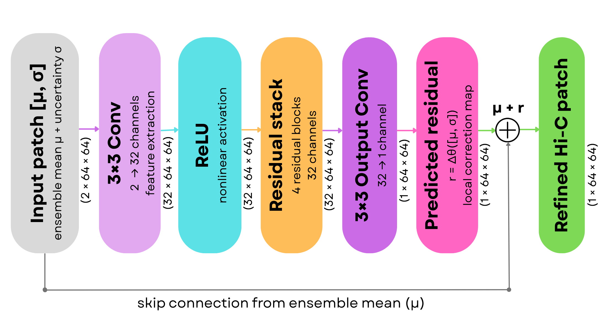

# UGR-HiC: Uncertainty-Guided Residual Refinement for Structure-Preserving Spatiotemporal Hi-C Forecasting

This repository contains the anonymous research implementation, experimental pipeline, and evaluation code used in the accompanying manuscript submitted for double-blind review.
<p align="center">
  
</p>
Our study extends the HiCForecast pipeline with uncertainty estimation, sparse graph-diffusion analysis, uncertainty-guided residual refinement, and structure-aware evaluation.

The repository supports:

- reproduction of the pretrained HiCForecast baseline;
- repeated deterministic inference as an uncertainty negative control;
- seeded checkpoint ensemble uncertainty;
- sparse top-\(k\) graph diffusion;
- uncertainty-guided residual refinement using UGR-HiC;
- PCC-based matched ground-truth selection;
- standard image-level evaluation;
- TAD insulation proxy evaluation;
- peak-weighted \(L_1\) evaluation;
- official GenomeDISCO evaluation;
- official TADCompare boundary-level analysis.

---
## 1. Overview

Time-resolved Hi-C data reveal how chromatin contacts reorganize across developmental and cellular transitions. However, generating dense temporal Hi-C measurements is experimentally expensive.

HiCForecast predicts future Hi-C contact maps from previous observations, but a single deterministic prediction does not reveal which contact-map regions are reliable. Moreover, strong image-level similarity does not necessarily guarantee preservation of biologically meaningful chromatin structures.

UGR-HiC addresses these limitations by using:

1. the seeded-ensemble mean prediction;
2. the pixel-wise ensemble standard deviation;
3. a lightweight residual convolutional network that learns local corrections.

UGR-HiC therefore refines the ensemble mean rather than generating a new contact map from scratch.

---

## 2. Pipeline

The complete experimental pipeline contains the following stages:

```text
Time-series Hi-C data
        ↓
Dataset and chromosome preprocessing
        ↓
HiCForecast baseline inference
        ↓
PCC-based matched ground-truth selection
        ↓
Repeated deterministic inference
        ↓
Seeded checkpoint ensemble
        ↓
Ensemble mean and uncertainty estimation
        ↓
Sparse GraphDiff analysis
        ↓
UGR-HiC residual refinement
        ↓
Standard and structure-aware evaluation
        ↓
GenomeDISCO and TADCompare analysis
```

The matched ground-truth mapping is selected using the reproduced baseline and is then kept fixed for all evaluated methods.

---

## 3. Repository structure

The GitHub repository should contain:

```text
UGR-HiC/
├── README.md
├── main.ipynb
├── TADCompare.ipynb
├── requirements.txt
├── .gitignore
├── LICENSE
│
├── assets/
│   ├── workflow.png
│   └── ugr_hic_architecture.png
│
├── data/
│   └── README.md
│
└── results/
    └── example/
```

The repository does not include:

- raw Hi-C datasets;
- complete `.cool` files;
- generated experiment folders;
- model checkpoints;
- large `.npy` arrays;
- Google Colab runtime files.

These files must be downloaded or generated separately.

---

## 4. Required Google Drive structure

The notebooks are designed primarily for Google Colab and expect the following structure:

```text
MyDrive/
└── UGR-HiC/
    ├── main.ipynb
    ├── TADCompare.ipynb
    │
    ├── HiCForecast-main/
    │   ├── scripts/
    │   │   ├── makedata.py
    │   │   ├── inference.py
    │   │   ├── train.py
    │   │   └── other HiCForecast files
    │   │
    │   └── trained_model/
    │       └── HiCForecast.pkl
    │
    ├── raw_original_datasets/
    │   ├── 1/
    │   ├── 2/
    │   ├── 3/
    │   ├── 4/
    │   └── 5/
    │
    ├── runs/          # created automatically
    └── runimages/     # created automatically
```

The user does not need to create `runs/` or `runimages/` manually. The main notebook creates these folders automatically.

---

## 5. External HiCForecast dependency

This repository builds on the official HiCForecast implementation.

Download or clone the official HiCForecast repository and place it at:

```text
/content/drive/MyDrive/UGR-HiC/HiCForecast-main/
```

The following files must exist:

```text
HiCForecast-main/scripts/makedata.py
HiCForecast-main/scripts/inference.py
HiCForecast-main/scripts/train.py
HiCForecast-main/trained_model/HiCForecast.pkl
```

Example:

```bash
cd /content/drive/MyDrive/UGR-HiC

git clone <OFFICIAL_HICFORECAST_REPOSITORY_URL> HiCForecast-main
```

Download the official pretrained checkpoint according to the HiCForecast instructions and place it at:

```text
HiCForecast-main/trained_model/HiCForecast.pkl
```

### Important version requirement

`main.ipynb` creates `train_seeded.py` by modifying the original HiCForecast `train.py` at runtime.

For reproducibility, record the exact HiCForecast commit used here:

```text
HiCForecast commit: <ADD_COMMIT_HASH>
```

A substantially different version of `train.py` may not contain the expected code blocks and may cause the automatic patching step to fail.

---

## 6. Datasets

The paper evaluates five spatiotemporal Hi-C datasets.

| ID | Biological process | Ordered time points |
|---|---|---|
| 1 | Mouse preimplantation development | PN5, early 2-cell, late 2-cell, 8-cell, ICM, mESC |
| 2 | Mouse embryogenesis | zygote, 2-cell, 4-cell, 8-cell, E3.5, E7.5 |
| 3 | Human development | 2-cell, 8-cell, morula, blastocyst, 6-week embryo, hESC |
| 4 | Mouse somatic-cell reprogramming | B, Ba, D2, D4, D6, D8 |
| 5 | Medaka gastrulation | ST11, ST12, ST13, ST14, ST18, ST27 |

The paper evaluates:

```text
chr16
chr19
```

All contact maps used for the paper experiments are processed at:

```text
40-kb resolution
```

---

## 7. Raw-data organization

Place each dataset under:

```text
/content/drive/MyDrive/UGR-HiC/raw_original_datasets/
```

The expected structure is:

```text
raw_original_datasets/
├── 1/
│   ├── PN5.cool
│   ├── early_2cell.cool
│   ├── late_2cell.cool
│   ├── 8cell.cool
│   ├── ICM.cool
│   └── mESC_500.cool
│
├── 2/
│   ├── zygote.cool
│   ├── 2-cell.cool
│   ├── 4-cell.cool
│   ├── 8-cell.cool
│   ├── E3.5.cool
│   └── E7.5.cool
│
├── 3/
│   ├── 2-cell.cool
│   ├── 8-cell.cool
│   ├── morula.cool
│   ├── blastocyst.cool
│   ├── 6-week.cool
│   └── hESC.cool
│
├── 4/
│   ├── B.cool
│   ├── Ba.cool
│   ├── D2.cool
│   ├── D4.cool
│   ├── D6.cool
│   └── D8.cool
│
└── 5/
    ├── st11.cool
    ├── st12.cool
    ├── st13.cool
    ├── st14.cool
    ├── st18.cool
    └── st27.cool
```

The filename stems must correspond to the ordered time-point names configured in `main.ipynb`.

If the downloaded files use different names, either rename them or update the `dataset_timepoints` dictionary.

---

## 8. Software requirements

The implementation is designed for Google Colab with GPU acceleration.

The paper experiments were executed using an NVIDIA Tesla T4 GPU.

### Python packages

The first cells of `main.ipynb` install or import the required Python packages.

The principal packages are:

```text
cooler
numpy
pandas
scipy
matplotlib
seaborn
scikit-image
scikit-learn
opencv-python
torch
lpips
pytorch-msssim
tqdm
```

Manual installation:

```bash
pip install \
    cooler \
    numpy \
    pandas \
    scipy \
    matplotlib \
    seaborn \
    scikit-image \
    scikit-learn \
    opencv-python \
    torch \
    lpips \
    pytorch-msssim \
    tqdm
```

### GenomeDISCO requirements

The GenomeDISCO section creates a separate Conda environment containing Python 2.7 because the official GenomeDISCO implementation depends on legacy packages.

The notebook automatically:

1. downloads Miniconda;
2. creates the `gd_py2` environment;
3. installs Python 2.7 dependencies;
4. clones the official GenomeDISCO repository;
5. runs the official GenomeDISCO implementation.

### TADCompare requirements

`TADCompare.ipynb` installs:

```text
R
R development tools
BiocManager
PRIMME
TADCompare
RcppCNPy
dplyr
ggplot2
cowplot
```

The notebook installs `PRIMME` before installing TADCompare to avoid the missing-dependency error that may occur in a fresh Colab environment.

---

## 9. Running the main notebook

Open:

```text
main.ipynb
```

in Google Colab.

Use a GPU runtime:

```text
Runtime → Change runtime type → T4 GPU
```

Run the notebook cells sequentially from the beginning.

Do not start from a middle section in a fresh Colab runtime because later experiments depend on variables and files produced by earlier sections.

---

## 10. User configuration

In the `USER CONFIGURATION` cell, set:

```python
dataset_id = "1"
inspection_cool_file = "8cell.cool"
chrom = "chr16"
```

Available dataset IDs are:

```text
1
2
3
4
5
```

Supported paper chromosomes are:

```text
chr16
chr19
```

The `inspection_cool_file` variable is used for initial data inspection and coordinate visualization.

The full pipeline subsequently processes all ordered time points listed for the selected dataset.

Example for Dataset 4, chromosome 19:

```python
dataset_id = "4"
inspection_cool_file = "D4.cool"
chrom = "chr19"
```

---

## 11. Automatic run-folder creation

Every execution creates a unique timestamped run folder:

```text
runs/
└── dataset_<ID>/
    └── <chromosome>/
        └── run_<dataset>_<inspection-file>_<chromosome>_<timestamp>/
```

Example:

```text
runs/
└── dataset_1/
    └── chr16/
        └── run_1_8cell_chr16_20260706_153000/
```

The notebook automatically creates all necessary experiment subfolders.

Do not manually create these output folders.

---

## 12. Execution order

Run the sections in the following order.

### 12.1 Dataset inspection

This section:

- checks the available `.cool` files;
- reads chromosome and bin information;
- inspects a selected genomic region;
- saves an example Hi-C heatmap.

Generated inspection figures are saved under:

```text
runimages/
```

### 12.2 Baseline inference

The notebook runs:

```text
HiCForecast-main/scripts/makedata.py
```

to generate:

```text
processed/
├── input_patches/
│   ├── data_<chromosome>_64.npy
│   └── data_index_<chromosome>_64.npy
└── data_gt_<chromosome>_64.npy
```

It then runs:

```text
HiCForecast-main/scripts/inference.py
```

using:

```text
HiCForecast-main/trained_model/HiCForecast.pkl
```

The baseline produces three future predictions:

```text
Y_t+1
Y_t+2
Y_t+3
```

### 12.3 PCC-based ground-truth matching

Each predicted horizon is compared with all candidate ground-truth stages using PCC.

For each horizon, the stage with the highest PCC is selected as the matched ground truth.

The selected mappings are saved and remain fixed for:

- baseline;
- seeded ensemble;
- GraphDiff;
- UGR-HiC;
- structure-aware evaluation;
- GenomeDISCO;
- TADCompare.

This ensures that different methods are not evaluated against different targets.

### 12.4 Experiment 1A: repeated deterministic inference

The same pretrained checkpoint is executed:

```text
K = 10 times
```

with identical inputs.

The notebook computes:

- repeated-prediction mean;
- repeated-prediction standard deviation;
- difference between repeated mean and baseline;
- horizon-specific uncertainty summaries.

This experiment serves as a negative control for uncertainty estimation.

### 12.5 Experiment 1B: seeded checkpoint ensemble

Three ensemble members are fine-tuned from the pretrained HiCForecast checkpoint using:

```text
Seeds: 11, 22, 33
Fine-tuning epochs: 5
Training batch size: 8
Patch size: 64 × 64
Maximum Hi-C value: 300
```

The notebook automatically creates:

```text
train_seeded.py
```

from the original HiCForecast `train.py`.

The notebook also evaluates:

- correlation between uncertainty and absolute error;
- MAE in the top 5% most uncertain pixels;
- MAE in the lower 95% of pixels;
- high-uncertainty to low-uncertainty error ratio.

### 12.6 Experiment 2A: sparse graph diffusion

The ensemble mean is interpreted as a weighted adjacency matrix.

For each row, the top-\(k\) contacts are retained and row-normalized to construct a sparse transition matrix.

Graph diffusion is evaluated using:

```text
k:
4, 8, 12, 16, 24, 32, 40, 48, 64, 80, 96, 128

alpha:
0.10, 0.20, 0.35, 0.50, 0.65, 0.80, 0.90, 0.95

steps:
1, 2, 3, 4, 5, 6, 8, 10
```

Total configurations:

```text
12 × 8 × 8 = 768
```

The best configuration is selected using the average rank across:

- PCC;
- SSIM;
- PSNR;
- MAE;
- MSE.

Higher values are preferred for PCC, SSIM, and PSNR. Lower values are preferred for MAE and MSE.

<p align="center">
  
</p>

### 12.7 Experiment 2B: UGR-HiC refinement

UGR-HiC uses two input channels:

```text
Channel 1: ensemble mean
Channel 2: ensemble uncertainty
```

Default refiner parameters:

```text
Patch size:             64 × 64
Stride:                  32
Overlap:                 50%
Maximum band offset:     2
Feature channels:        32
Residual blocks:         4
Training epochs:         90
Batch size:              32
Learning rate:           1e-3
Training fraction:       80%
Validation fraction:     20%
Random seed:             42
Optimizer:               Adam
Loss:                    L1
```

The model contains:

```text
74,881 trainable parameters
```

The notebook retains the checkpoint with the lowest validation loss.

During full-map reconstruction:

- overlapping patches are averaged;
- uncovered regions retain the ensemble-mean prediction;
- the reconstructed matrix is symmetrized;
- negative values are clipped to zero.

### 12.8 Experiment 3A: TAD insulation proxy

The TAD insulation proxy compares local diagonal-domain profiles.

Default parameter:

```text
Insulation window: 10 bins
```

Lower values indicate better agreement with the matched ground truth.

### 12.9 Experiment 3B: peak-weighted L1

Errors in high-contact ground-truth regions receive additional weight.

Default parameters:

```text
Peak percentile: 95
Peak weight:     5.0
```

Lower values indicate better high-contact-region agreement.

### 12.10 Experiment 3C: official GenomeDISCO

GenomeDISCO is evaluated on common valid diagonal patches.

Default patch configuration:

```text
Patch size: 64 × 64
Stride:     32
Resolution: 40,000 bp
```

The official GenomeDISCO configuration is:

```text
subsampling: lowest
tmin:        3
tmax:        3
normalization: sqrtvc
removeDiag:  yes
transition:  yes
```

The notebook generates:

- patch-level scores;
- horizon-level summaries;
- method-level summaries;
- a final evaluation table containing GenomeDISCO.

Higher GenomeDISCO values indicate better contact-map concordance.

---

## 13. Running TADCompare

Run `TADCompare.ipynb` only after completing the relevant `main.ipynb` experiment.

For the representative paper analysis, the default configuration is:

```python
PROJECT_ROOT = Path("/content/drive/MyDrive/UGR-HiC")

RUNS_ROOT = (
    PROJECT_ROOT
    / "runs"
    / "dataset_1"
    / "chr16"
)

RAW_COOL_PATH = (
    PROJECT_ROOT
    / "raw_original_datasets"
    / "1"
    / "8cell.cool"
)

CHROMOSOME = "chr16"
```

The notebook selects the most recently modified run folder under:

```text
runs/dataset_1/chr16/
```

Always check the printed line:

```text
Selected run: ...
```

before continuing.

For stricter reproducibility, an explicit run folder can be selected instead of automatically selecting the latest run.

Example:

```python
RUN_DIR = (
    PROJECT_ROOT
    / "runs"
    / "dataset_1"
    / "chr16"
    / "run_1_8cell_chr16_20260706_153000"
)
```

---

## 14. TADCompare analysis

The TADCompare notebook performs:

```text
3 forecast horizons × 4 methods = 12 comparisons
```

The evaluated methods are:

- Baseline;
- Seeded ensemble mean;
- GraphDiff;
- UGR-HiC.

Default TADCompare parameters:

```text
z threshold:        2.0
window size:        15
gap threshold:      0.20
representative span: ±4 Mb
```

The notebook exports:

- TAD boundary classifications;
- boundary scores;
- serialized R objects;
- all-method summaries;
- baseline-versus-UGR-HiC comparisons;
- representative-region metadata;
- the representative comparison figure.

The representative interval is selected using a predefined procedure that prioritizes boundaries classified as differential in the baseline and non-differential after UGR-HiC refinement.

---

## 15. Generated output structure

A completed run has approximately the following structure:

```text
runs/
└── dataset_1/
    └── chr16/
        └── run_1_8cell_chr16_<timestamp>/
            ├── run_config.json
            ├── pred_baseline.npy
            ├── gt_chr16.npy
            │
            ├── processed/
            │   ├── input_patches/
            │   └── data_gt_chr16_64.npy
            │
            ├── predictions/
            ├── images/
            ├── logs/
            ├── metrics/
            │   └── baseline_metrics_dataset1_chr16.csv
            │
            ├── exp1A_repeated_deterministic/
            │   ├── repeat_predictions/
            │   ├── logs/
            │   └── results/
            │
            ├── exp1B_seeded_checkpoint_ensemble/
            │   ├── checkpoints/
            │   ├── train_patches/
            │   ├── member_predictions/
            │   ├── results/
            │   ├── logs/
            │   └── images/
            │
            ├── exp2A_sparse_graph_diffusion/
            │   ├── predictions/
            │   ├── results/
            │   ├── images/
            │   └── logs/
            │
            ├── exp2B_uncertainty_guided_refiner/
            │   ├── patches/
            │   ├── models/
            │   ├── results/
            │   ├── logs/
            │   └── images/
            │
            ├── exp3_structure_aware_final_evaluation/
            │   ├── results/
            │   └── images/
            │
            ├── exp3C_genomedisco/
            │   ├── inputs/
            │   ├── outputs/
            │   ├── results/
            │   └── logs/
            │
            └── exp3D_tadcompare_<timestamp>/
                ├── inputs/
                │   └── matrices/
                ├── results/
                │   ├── boundary_tables/
                │   └── r_objects/
                ├── figures/
                └── logs/
```

---

## 16. Important output files

### Baseline

```text
pred_baseline.npy
gt_<chromosome>.npy
metrics/baseline_metrics_dataset<ID>_<chromosome>.csv
```

### Deterministic-repeat experiment

```text
exp1A_repeat_mean_dataset<ID>_<chromosome>.npy
exp1A_repeat_std_dataset<ID>_<chromosome>.npy
exp1A_deterministic_repeat_summary_dataset<ID>_<chromosome>.csv
exp1A_run_info_dataset<ID>_<chromosome>.json
```

### Seeded ensemble

```text
exp1B_member_predictions_dataset<ID>_<chromosome>.npy
exp1B_ensemble_mean_dataset<ID>_<chromosome>.npy
exp1B_ensemble_std_dataset<ID>_<chromosome>.npy
exp1B_corr_sigma_error_dataset<ID>_<chromosome>.csv
exp1B_paper_table_dataset<ID>_<chromosome>.csv
```

### GraphDiff

```text
exp2A_hyperparameter_sweep_dataset<ID>_<chromosome>.csv
exp2A_top20_hyperparameters_dataset<ID>_<chromosome>.csv
exp2A_best_graphdiff_pred_dataset<ID>_<chromosome>.npy
exp2A_best_graphdiff_metrics_dataset<ID>_<chromosome>.csv
```

### UGR-HiC

```text
exp2B_best_refiner_dataset<ID>_<chromosome>.pt
exp2B_training_history_dataset<ID>_<chromosome>_epoch_90.csv
exp2B_refined_patches_dataset<ID>_<chromosome>_epoch_90.npy
exp2B_refined_full_dataset<ID>_<chromosome>_epoch_90.npy
exp2B_method_comparison_dataset<ID>_<chromosome>_epoch_90.csv
```

### Structure-aware evaluation

```text
exp3_structure_aware_metrics_dataset<ID>_<chromosome>.csv
exp3_structure_aware_summary_dataset<ID>_<chromosome>.csv
final_evaluation_standard_plus_structure_dataset<ID>_<chromosome>.csv
```

### GenomeDISCO

```text
exp3C_official_genomedisco_patch_scores_dataset<ID>_<chromosome>.csv
exp3C_official_genomedisco_horizon_summary_dataset<ID>_<chromosome>.csv
exp3C_official_genomedisco_method_summary_dataset<ID>_<chromosome>.csv
final_evaluation_with_official_genomedisco_dataset<ID>_<chromosome>.csv
```

### TADCompare

```text
tadcompare_summary_all_methods.csv
tadcompare_baseline_vs_ugrhic.csv
tadcompare_method_means.csv
tadcompare_interpretation.csv
representative_region.csv
representative_TADCompare.png
representative_TADCompare.pdf
```

---

## 17. Reproducing the complete paper evaluation

To reproduce the complete main results table, run the following ten dataset–chromosome combinations:

```text
Dataset 1: chr16
Dataset 1: chr19

Dataset 2: chr16
Dataset 2: chr19

Dataset 3: chr16
Dataset 3: chr19

Dataset 4: chr16
Dataset 4: chr19

Dataset 5: chr16
Dataset 5: chr19
```

For each run:

1. change `dataset_id`;
2. change `inspection_cool_file`;
3. change `chrom`;
4. restart the notebook runtime if necessary;
5. run all cells sequentially;
6. retain the automatically generated run folder;
7. collect the final evaluation CSV.

The manuscript reports values averaged over the three forecast horizons.

---

## 18. Reusing the framework on another dataset

To apply the pipeline to another time-series Hi-C dataset:

1. convert all stages to `.cool` format;
2. use a consistent genomic resolution across all stages;
3. ensure the selected chromosome exists in every file;
4. place the files in a new dataset folder;
5. add the ordered time-point stems to `dataset_timepoints`;
6. run baseline preprocessing and inference;
7. inspect the PCC-based matched ground-truth mapping;
8. keep that mapping fixed for all subsequent methods;
9. run Experiments 1A, 1B, 2A, 2B, and 3;
10. save the complete configuration and software environment.

Example:

```python
dataset_timepoints["6"] = [
    "stage_1",
    "stage_2",
    "stage_3",
    "stage_4",
    "stage_5",
    "stage_6",
]
```

Then place:

```text
raw_original_datasets/6/
├── stage_1.cool
├── stage_2.cool
├── stage_3.cool
├── stage_4.cool
├── stage_5.cool
└── stage_6.cool
```

---

## 19. Reproducibility notes

For the most reproducible execution:

- use the same raw `.cool` files;
- retain the original time-point order;
- use the same 40-kb resolution;
- use the same HiCForecast checkpoint;
- record the HiCForecast commit hash;
- use the configured seeds 11, 22, and 33;
- retain the same matched ground-truth mappings;
- use the same GraphDiff search space;
- use the same UGR-HiC parameters;
- keep all generated `run_config.json` files;
- save Colab package versions for the final archival release.

GPU operations and library versions may cause very small numerical differences. Therefore, independently reproduced results should be numerically close but are not guaranteed to be bitwise identical.

---

## 20. Troubleshooting

### Raw dataset folder not found

Error:

```text
Raw dataset folder not found
```

Check that the folder exists at:

```text
/content/drive/MyDrive/UGR-HiC/raw_original_datasets/
```

### HiCForecast repository not found

Error:

```text
HiCForecast repository not found
```

Check that the official repository is located at:

```text
/content/drive/MyDrive/UGR-HiC/HiCForecast-main/
```

### Pretrained checkpoint not found

Check:

```text
/content/drive/MyDrive/UGR-HiC/HiCForecast-main/trained_model/HiCForecast.pkl
```

### `makedata.py` failure

Check:

- `.cool` filenames;
- time-point order;
- chromosome availability;
- output logs under the current run’s `logs/` directory.

### `train_seeded.py` patch failure

This usually means that the downloaded HiCForecast `train.py` differs from the version expected by the notebook.

Use the same HiCForecast commit used for the reported experiments.

### Wrong TADCompare run selected

Check the notebook output:

```text
Selected run: ...
```

If it selects the wrong run, set `RUN_DIR` explicitly instead of automatically selecting the latest folder.

### TADCompare missing `PRIMME`

Run the complete R installation cell. It installs `PRIMME` before installing TADCompare.

### GenomeDISCO failure

Check:

```text
exp3C_genomedisco/logs/genomedisco_batch_stdout.txt
exp3C_genomedisco/logs/genomedisco_batch_stderr.txt
```

Also verify that the `gd_py2` Conda environment was created successfully.

### CUDA out-of-memory error

Restart the Colab runtime and run one dataset–chromosome pair at a time.

Changing batch size may affect exact reproducibility, so retain the paper settings for final experiments.

---

## 21. Results summary

Across the evaluated dataset–chromosome combinations, UGR-HiC generally improved:

- PCC;
- SSIM;
- PSNR;
- MAE;
- MSE;
- TAD insulation proxy agreement;
- peak-weighted \(L_1\);
- GenomeDISCO concordance.

The seeded-ensemble uncertainty was positively associated with local absolute prediction error, whereas repeated deterministic inference produced negligible uncertainty.

Sparse graph diffusion generally required conservative smoothing and produced smaller improvements than the learned UGR-HiC residual refinement.

TADCompare was used as an additional boundary-level evaluation for the representative Dataset 1, chromosome 16 analysis.

---

## 22. Data availability

Raw Hi-C datasets are not redistributed through this repository because of their size and original data-distribution requirements.

Dataset sources and citations are provided in the accompanying manuscript.

A future archival release may provide:

- processed example inputs;
- selected output arrays;
- trained UGR-HiC checkpoints;
- complete result CSV files;
- environment specifications.

---

## 23. Anonymous review

This repository is prepared for double-anonymous peer review.

During review, please do not add:

- author names;
- institution names;
- laboratory names;
- personal email addresses;
- personal GitHub usernames;
- identifying Google Drive links;
- acknowledgments revealing authorship.

The permanent public repository and author information will be added after completion of the review process.

---

## 24. Citation

The manuscript is currently under anonymous review.

Citation information will be added after publication.

```bibtex
@article{ugrhic,
  title   = {UGR-HiC: Uncertainty-Guided Residual Refinement for
             Structure-Preserving Spatiotemporal Hi-C Forecasting},
  author  = {Anonymous},
  journal = {Under Review},
  year    = {2026}
}
```

---

## 25. Third-party software

This project uses or builds upon:

- HiCForecast;
- PyTorch;
- Cooler;
- GenomeDISCO;
- TADCompare;
- scikit-image;
- scikit-learn;
- LPIPS;
- pytorch-msssim.

Third-party software remains subject to its original license and citation requirements.

---

## 26. License

See the `LICENSE` file for the license governing the original code in this repository.

Third-party code, datasets, and pretrained models retain their respective original licenses.

---

## 27. Contact

Contact information is intentionally omitted during double-anonymous review.

A permanent contact address will be added after the review process.
