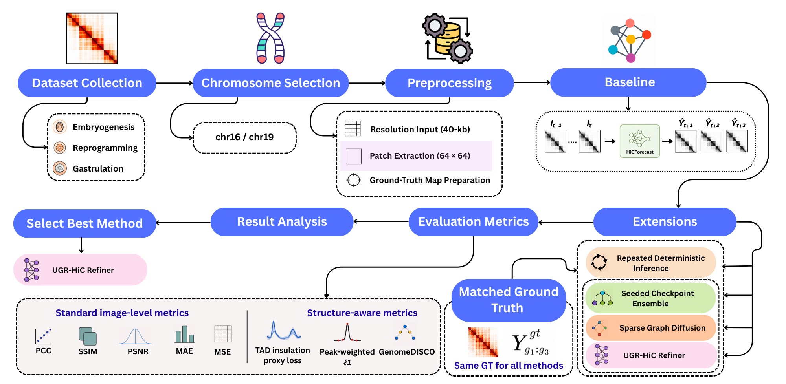

# UGR-HiC: Uncertainty-Guided Residual Refinement for Structure-Preserving Spatiotemporal Hi-C Forecasting

<p align="center">
  
</p>

UGR-HiC extends [HiCForecast](https://github.com/OluwadareLab/HiCForecast) with seeded-ensemble uncertainty estimation, sparse graph diffusion, and uncertainty-guided residual refinement for spatiotemporal Hi-C forecasting. This repository contains the notebooks used for the baseline, UGR-HiC experiments, and structure-aware evaluation.

## 📂 Repository Structure

```text
UGR-HiC/
├── assets/                                  # Workflow figure
├── 00_Installation_and_Data_Setup.ipynb    # Colab/Drive and raw-data setup
├── main.ipynb                              # Baseline, experiments, and GenomeDISCO
├── TADCompare.ipynb                        # TAD boundary-level analysis
├── requirements.txt                        # Python dependencies for main.ipynb
└── README.md
```

## 🛠️ Installation and Data

Run the notebooks in **Google Colab**, using a Google Drive account with enough space for the downloaded Hi-C archive and generated results. Select **Runtime → Change runtime type → GPU** before running the main experiments.

1. Open [`00_Installation_and_Data_Setup.ipynb`](00_Installation_and_Data_Setup.ipynb) in Colab and run the cells **from top to bottom**. The notebook mounts Google Drive, installs `cooler`, clones **UGR-HiC** and **HiCForecast**, downloads the [original HiCForecast dataset archive](https://zenodo.org/records/14531696), extracts the `.cool` files, and checks dataset resolution and chromosome availability.
2. Confirm the notebook prints `True` for the UGR-HiC notebook, HiCForecast's `scripts/inference.py`, and the pretrained checkpoint `HiCForecast-main/trained_model/HiCForecast.pkl`. The checkpoint must exist before inference.
3. Run repository-cloning cells only for a **first-time installation**. If the folders already exist in Drive, keep them and proceed to verification/data preparation instead of cloning into them again.

The setup notebook uses this Google Drive layout:

```text
MyDrive/
└── UGR-HiC/
    ├── HiCForecast-main/
    │   └── trained_model/
    │       └── HiCForecast.pkl
    ├── raw_original_datasets/
    │   ├── 1/
    │   ├── 2/
    │   ├── 3/
    │   ├── 4/
    │   ├── 5/
    │   └── 6/
    └── runs/                         # Created during experiments
```

The manuscript reports experiments on five datasets at **40-kb resolution**, using `chr16` and `chr19`. The setup notebook extracts available dataset folders numbered 1–6 from the source archive.

## 🚀 Usage

### 1. Run `main.ipynb`

Open [`main.ipynb`](main.ipynb) in Colab. Its installation cell runs `%pip install -q -r /content/drive/MyDrive/UGR-HiC/requirements.txt`. In the **Dataset Inspection** section, set `dataset_id`, `cool_file`, and `chrom` (the current example is `"5"`, `"st11.cool"`, and `"chr16"`). Then run the following sections in order:

1. Dataset inspection and HiCForecast baseline inference
2. Repeated deterministic inference (Experiment 1A)
3. Seeded checkpoint ensemble and uncertainty estimation (Experiment 1B)
4. Sparse graph diffusion (Experiment 2A)
5. Uncertainty-guided residual refinement (Experiment 2B)
6. Structure-aware evaluation: TAD insulation, peak-weighted L1, and official GenomeDISCO (Experiment 3)

**GenomeDISCO:** The Experiment 3C cells install Miniconda, create the `gd_py2` Python 2.7 environment, install the [official GenomeDISCO implementation](https://github.com/kundajelab/genomedisco), and run its evaluation. These are separate from `requirements.txt`.

Results, checkpoints, figures, and logs are written under `MyDrive/UGR-HiC/runs/dataset_<ID>/<chrom>/run_*/`. The PCC-based baseline GT matching is reused across methods.

### 2. Run `TADCompare.ipynb`

After completing the main experiments, open [`TADCompare.ipynb`](TADCompare.ipynb). The notebook is configured for **Dataset 1, chromosome 16**, using these paths:

```python
RUNS_ROOT = Path("/content/drive/MyDrive/UGR-HiC/runs/dataset_1/chr16")
RAW_COOL_PATH = Path("/content/drive/MyDrive/UGR-HiC/raw_original_datasets/1/8cell.cool")
CHROMOSOME = "chr16"
```

For another dataset or chromosome, set these paths to the corresponding completed experiment. TADCompare selects the most recently modified `run_*` folder under `RUNS_ROOT` and loads the saved baseline, ensemble, graph-diffusion, and UGR-HiC predictions. The notebook installs **R, PRIMME, TADCompare (Bioconductor), and the required R packages** before evaluation.

## 📊 Output

All predictions, checkpoints, metrics, figures, and logs are saved automatically to Google Drive under:

`MyDrive/UGR-HiC/runs/dataset_<ID>/<chromosome>/run_<ID>_<file>_<chromosome>_<year>/`

Example output structure for Dataset 1, chromosome 16:

```text
runs/
└── dataset_1/
    └── chr16/
        └── run_1_8cell.cool_chr16_2026/
            ├── run_config.json
            ├── pred_baseline.npy
            ├── gt_chr16.npy
            ├── processed/
            ├── predictions/
            ├── images/
            ├── logs/
            ├── metrics/
            ├── exp1A_repeated_deterministic/
            ├── exp1B_seeded_checkpoint_ensemble/
            ├── exp2A_sparse_graph_diffusion/
            ├── exp2B_uncertainty_guided_refiner/
            ├── exp3_structure_aware_final_evaluation/
            ├── exp3C_genomedisco/
            └── exp3D_tadcompare_<timestamp>/
```

Each experiment writes to its own subdirectory. TADCompare creates a timestamped folder in the selected run.

## 📦 Dependencies

Python packages are listed in [`requirements.txt`](requirements.txt) and installed by `main.ipynb`. GenomeDISCO and TADCompare use the separate installation steps documented above.

### Developer

**Abdullah Al Naseeh Chowdhury**   
Department of Computer Science and Engineering, University of North Texas  
Email: [AbdullahAlNaseehChowdhury@my.unt.edu](mailto:AbdullahAlNaseehChowdhury@my.unt.edu)

## Contact

**Dr. Oluwatosin Oluwadare**  
Department of Computer Science and Engineering, University of North Texas  
Email: [Oluwatosin.Oluwadare@unt.edu](mailto:Oluwatosin.Oluwadare@unt.edu)

### [OluwadareLab, University of North Texas](https://oluwadarelab.com/)

<div style="background-color: black; padding: 20px; text-align: start; border-radius: 8px;">
  
</div>

## ⚖️ License

Distributed under the MIT License. See `LICENSE` for more information.

## Acknowledgment

UGR-HiC builds on the [HiCForecast](https://github.com/OluwadareLab/HiCForecast) framework. Please also cite the original [HiCForecast publication](https://doi.org/10.1093/bioinformatics/btaf030) when using its implementation.
